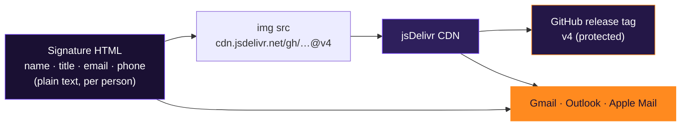

<div align="center">


# BCFM Email Signature

**Shared, versioned image assets for the Bestcloudfor.me team email signature**

One HTML signature per person, one set of brand images for everyone — served from this repo through jsDelivr.

[](https://github.com/bestcloudforme/bcfm-email-signature/releases)
[](https://www.jsdelivr.com/)
[](#add-to-gmail)
[](#dark-mode)
[](#versioning)

[**What & why**](#what-it-is) · [**How it works**](#how-it-works) · [**Quickstart**](#quickstart) · [**Assets**](#assets) · [**Versioning**](#versioning)

</div>

> [!WARNING]
> **Do not delete, rename or overwrite files referenced by a tag.** Every signature that has already been sent loads its images from this repo. If a tagged image changes or disappears, it breaks in every inbox.

---

## What it is

This repo hosts the **brand images** used in the Bestcloudfor.me email signature: the logo card, social icons, contact icons and link buttons. Each person's signature is a small HTML snippet that keeps their name, title, email and phone as plain text and pulls the shared images from here through [jsDelivr](https://www.jsdelivr.com/).

<table>
<tr>
<td width="50%" valign="top">

#### 🌗 Dark-mode safe
Gmail's mobile app inverts colors in dark mode. Logo, icons and buttons carry their own background inside the image, so they stay purple and readable in both light and dark mode.

</td>
<td width="50%" valign="top">

#### 🔒 No personal data
Only shared brand images live here. Names, titles, emails and phone numbers stay in each person's HTML signature and are **never** committed.

</td>
</tr>
<tr>
<td width="50%" valign="top">

#### ⚡ Zero hosting
No S3, no CloudFront, no server. GitHub stores the files, jsDelivr serves them over a global CDN with the right content type.

</td>
<td width="50%" valign="top">

#### 📌 Pinned & immutable
Signatures reference a release tag (`@v4`), never `main`. Tags are protected by a ruleset, so sent emails keep rendering even when the repo changes.

</td>
</tr>
</table>

---

## How it works



Image URL format:

```
https://cdn.jsdelivr.net/gh/bestcloudforme/bcfm-email-signature@v4/<file>.png
```

---

## Quickstart

<details open>
<summary><b id="add-to-gmail">Add to Gmail</b></summary>

1. Open your `<name>-gmail-imza.html` file in **Chrome**.
2. Click an empty area, then `Cmd+A` / `Ctrl+A` and `Cmd+C` / `Ctrl+C`. Copy the rendered signature, not the source.
3. Gmail → ⚙️ → **See all settings** → **General** → **Signature** → **Create new** → name it `BCFM`.
4. Paste with `Cmd+V` / `Ctrl+V`. Do **not** paste as plain text.
5. Under **Signature defaults**, select `BCFM` for both new emails and replies.
6. Scroll to the bottom and click **Save Changes**, then send yourself a test email.
</details>

<details>
<summary><b>Add a new teammate</b></summary>

No new images are needed. The shared assets cover everyone.

1. Copy an existing signature HTML file.
2. Replace the name, title, email, phone (`tel:` link included) and LinkedIn URL.
3. Keep every image URL on the current tag (`@v4`).
4. Open it in Chrome to check, then follow **Add to Gmail**.
</details>

<details>
<summary><b>Replace an old signature</b></summary>

In Gmail signature settings, open the existing `BCFM` signature, select everything inside the editor and delete it, then paste the new one and **Save Changes**.
</details>

---

## Assets

Current release: **v4**. All images are exported at 2× for high-DPI screens.

<table>
<tr><th align="left">File</th><th align="left">Used for</th><th align="left">Display size</th></tr>
<tr><td><code>card.png</code></td><td>Logo card with AWS Premier Tier Partner badge</td><td>180×141</td></tr>
<tr><td><code>soc_linkedin.png</code></td><td>Company LinkedIn</td><td>26×26</td></tr>
<tr><td><code>soc_youtube.png</code></td><td>Company YouTube</td><td>26×26</td></tr>
<tr><td><code>soc_instagram.png</code></td><td>Company Instagram</td><td>26×26</td></tr>
<tr><td><code>soc_x.png</code></td><td>Company X</td><td>26×26</td></tr>
<tr><td><code>c_mail.png</code></td><td>Email icon</td><td>14×14</td></tr>
<tr><td><code>c_phone.png</code></td><td>Phone icon</td><td>14×14</td></tr>
<tr><td><code>c_linkedin.png</code></td><td>Personal LinkedIn icon</td><td>14×14</td></tr>
<tr><td><code>btn_web.png</code></td><td>bestcloudfor.me button</td><td>134×26</td></tr>
<tr><td><code>btn_medium.png</code></td><td>Medium Blog button</td><td>113×26</td></tr>
<tr><td><code>btn_podcast.png</code></td><td>Devopsology Podcast button</td><td>157×26</td></tr>
</table>

### Dark mode

> [!NOTE]
> Gmail's iOS and Android apps force-invert HTML background and text colors in dark mode, and there is no CSS that disables this inside a signature. The signature background turns light lavender and the text turns dark. That is expected. Images are never inverted, which is why every brand element is an image with its own background.

---

## Versioning

Every visual change ships as a **new tag**. Existing tags are never modified.

1. Add the new or changed images. Do not overwrite files a live tag still uses.
2. Create a release with the next tag (`v5`, `v6`, …).
3. Update the signature HTML files to the new tag and re-paste them in Gmail.

Older tags stay frozen, so signatures in emails that were already sent keep rendering.

<details>
<summary><b>🛡️ Repo protection</b></summary>

- **Access:** base role `None`, direct access limited to the maintainer.
- **Tag ruleset:** `v*` tags have **Restrict updates** and **Restrict deletions** enabled.
- Org owners can still bypass rulesets, so treat tags as immutable by convention as well.
</details>

<details>
<summary><b>🚫 What not to commit</b></summary>

- Signature HTML files. They contain personal emails and phone numbers.
- Any image with personal data baked in.
- Anything other than brand image assets and this README.
</details>

---

<div align="center"><sub>© bestcloudfor.me · All rights reserved · Brand assets are property of bestcloudfor.me · <a href="#what-it-is">back to top ↑</a></sub></div>
